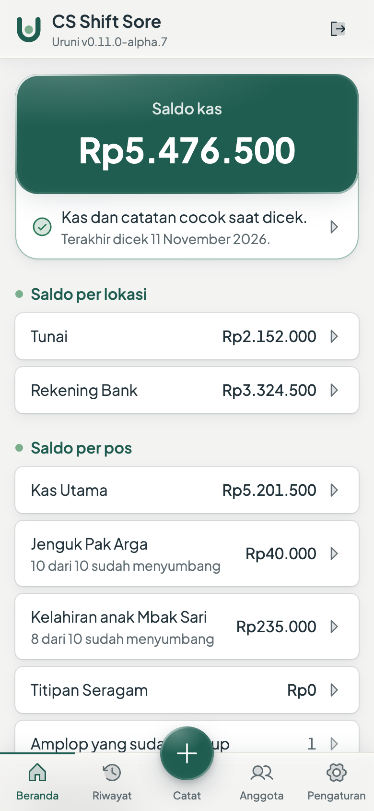
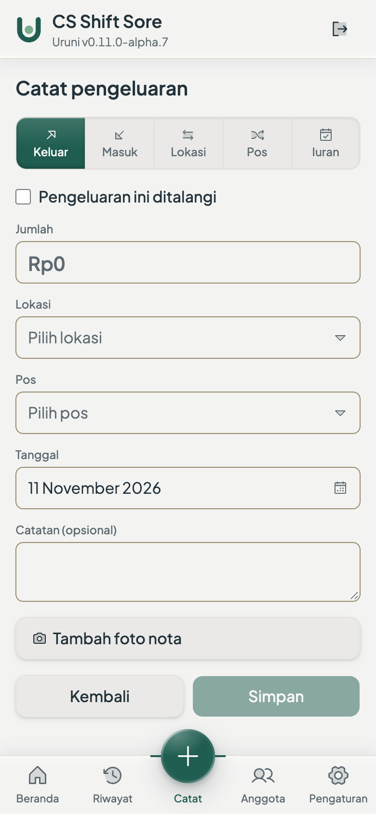
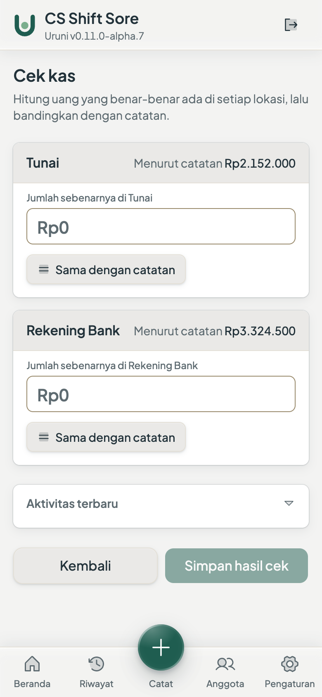
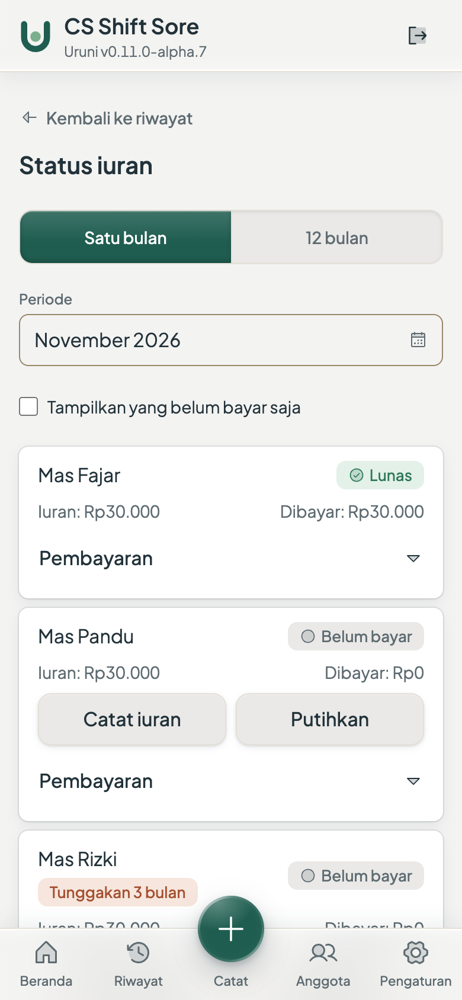

<div align="center">

<picture>
  <source media="(prefers-color-scheme: dark)" srcset="docs/brand/uruni-lockup-horizontal-reversed.svg">
  
</picture>

### Kelola dana kebersamaan.

**Your community's shared money, recorded from a phone, and always matching the cash.**

A small, calm app for the treasurer nobody trained: dues, collections and reimbursements in a few taps,
and a reconciliation check that tells you the books and the wallet agree.

[Live demo](https://demo.uruni.kerti.dev) · [Website](https://uruni.kerti.dev) · [Self-hosting](SELF-HOSTING.md) · [The domain model](CONTEXT.md)

[](https://github.com/kerti/uruni/actions/workflows/ci.yml)
[](https://github.com/kerti/uruni/releases)
[](https://codecov.io/gh/kerti/uruni)
[](LICENSE)

*Open source · Self-hosted · Free forever*

<br>

&nbsp;
&nbsp;
&nbsp;


<sub>The balance at a glance · Record from your phone · Check the cash against the books · See who has paid</sub>

<sub>Screens from the [live demo](https://demo.uruni.kerti.dev), an invented office fund.</sub>

</div>

---

## Who it's for

The person who got told *"Bu, jadi bendahara ya"*, didn't ask for it, and now looks after a small group's
money: monthly dues, birthdays, graduations, bereavement donations, team lunches. Office units, RT,
churches, choirs, alumni, family clans, hobby groups, roughly 5 to 20 people.

Their hardest job isn't chasing people. In a small group, nagging is fine. It's **making the recorded
balance match the real money.** Cash lives in two places, routine and incidental funds get lumped
together, and someone always takes cash to shop and forgets to write it down. So the numbers drift.

Uruni does one job extremely well: **keep a small group's shared fund honest, with the least possible
thinking.**

> **Tenang, karena catatan selalu cocok dengan uang yang ada.**
> *Calm, because the records always match the money.*

## What you get

- **One-tap capture, anywhere.** Record a transaction from a phone at a market stall. The thing a
  spreadsheet can't do.
- **A balance that's always honest.** A simple reconciliation check asks whether what's recorded matches
  the cash in the wallet and the money in the account, and shows the gap instead of making you hunt for it.
- **Cash and bank, kept apart**, because that split is where discrepancies come from.
- **One pooled balance with purpose tags.** Kas utama, incidental collections, pass-through money held for
  someone else: separated *in meaning*, without juggling separate pots.
- **Dues that vary by member**, and a simple "who's paid" view.
- **Reimbursements in seconds, receipts optional.** Nobody wants a receipt for Rp2.000 of parking.
- **A public report anyone can open** from its own link, to see where the money went. No login needed.
- **Backups you can hold**: daily dumps on the server and a one-click export.

That's the whole product. On purpose.

## Try it

- **Live demo**: [demo.uruni.kerti.dev](https://demo.uruni.kerti.dev) runs the latest release over fourteen
  months of an invented office fund, *CS Shift Sore*. The login is filled in for you
  (`demo@uruni.test` / `coba-uruni`). Change anything you like; it starts clean again at least every hour.
  Its public report is at
  [demo.uruni.kerti.dev/report/CsShiftSoreDemoUruni2026](https://demo.uruni.kerti.dev/report/CsShiftSoreDemoUruni2026).
- **Run your own**: one `docker-compose.yml`, a published image, Caddy for HTTPS. See below.

## Your server, your records

Every comparable app is a *company's server* holding your community's financial records. With Uruni, the
server is **yours**.

- **The project holds nothing.** Uruni runs no production service and stores none of your data. Ever.
- **Self-hosted.** A community runs its own always-on instance: one source of truth, so a lost or broken
  phone loses nothing.
- **AGPL-3.0.** Anyone who modifies Uruni and offers it over a network must offer those users the source.
  The trust story is auditable and true by construction.
- **Data minimization.** Names, amounts, dates, notes. No member emails or phone numbers are collected.

## Self-hosting

A single image, `ghcr.io/kerti/uruni:<tag>`, behind Caddy for automatic HTTPS. Any small Linux VPS with
Docker Compose and a domain name will do.

```sh
cp env.example .env                                              # set URUNI_BASE_URL
docker compose up -d app                                         # app only, not reachable yet
docker compose exec app /uruni create-user treasurer@example.org # the treasurer's login
docker compose up -d                                             # Caddy fetches the certificate
```

Take the files from the release you pin, not from `main`. The full walkthrough, including why the login
comes before Caddy, backups, upgrades and rollback, is in [`SELF-HOSTING.md`](SELF-HOSTING.md).

Honest caveat: this is **not** a tap-to-install consumer app. Standing up an instance takes a technical
helper, and we don't pretend otherwise.

## What Uruni will never be

Not an operating system for your RT or organization: no resident databases, digital voting, complaint
handling, visitor logs, inventory, QRIS reconciliation, bank sync, accounting journals or analytics
dashboards. And, deliberately, **not a payment-chasing or reminder machine**: for the treasurer we
validated, chasing wasn't the pain, reconciliation was.

> There are excellent products for those. Uruni exists to help small communities keep their shared fund
> honest, from a phone, without thinking hard.

The full non-goals list is [`docs/PRD.md` section 4](docs/PRD.md).

## Principles

1. **Small groups first.**
2. **Simpler than a spreadsheet**, and reliable enough to replace it.
3. **Mobile-first**: capture anywhere.
4. **The numbers always add up, and Uruni proves it.**
5. **Records that can't be lost.**
6. **Your data stays yours**, on your community's own server.
7. **Free, forever.** A gift to communities, not a business. There is no paid tier and never will be.
8. **No feature creep, ever.**

## How it's built

A single **Go** binary serves the JSON API, server-renders the public report, and serves an embedded
**React** PWA: one origin, one process, **SQLite** as the only store. Money is integer rupiah end to end,
balances are summed from an immutable ledger, and corrections are new entries, never edits.

The app is **connection-required by design**: no local data store, no write queue, no offline sync. When
disconnected it says so plainly ("butuh koneksi"). The validated user preferred no "which copy is
valid?" ambiguity over any offline capability.

Uruni speaks like a helpful friend, not software, in Bahasa Indonesia:

- *"Pengeluaran berhasil dicatat."*
- *"Kas dan catatan cocok saat dicek. 🎉"*
- *"Ada selisih Rp15.000, mau dicek bersama?"*

Details in [`docs/Tech-Design.md`](docs/Tech-Design.md); the decisions themselves are one file per ADR
in [`docs/ADR/`](docs/ADR/README.md).

## Status

**Public alpha.** The everyday loop works on a phone: record, see the balance, reconcile, share the
report. Self-hosters can run the `0.x` alphas today; the upgrade contract starts at `v1.0.0`. What's in
flight is the current [GitHub milestone](https://github.com/kerti/uruni/milestones) and its open issues.

## Documentation

| Doc | What's in it |
|---|---|
| [`docs/Positioning.md`](docs/Positioning.md) | The product thesis and emotional core |
| [`docs/PRD.md`](docs/PRD.md) · [`docs/PRD-ID.md`](docs/PRD-ID.md) | What to build and why (English / Indonesian) |
| [`docs/Tech-Design.md`](docs/Tech-Design.md) | Stack and architecture, the overview |
| [`docs/ADR/`](docs/ADR/README.md) | The architecture decisions, one file each |
| [`docs/Design-System.md`](docs/Design-System.md) | Colors, type, components, voice |
| [`docs/ROADMAP.md`](docs/ROADMAP.md) | Milestones and release cadence |
| [`docs/Decisions.md`](docs/Decisions.md) | The running decision log |
| [`CONTEXT.md`](CONTEXT.md) | The domain vocabulary: use these exact words |
| [`CONTRIBUTING.md`](CONTRIBUTING.md) | Setup, workflow, and the scope bar |
| [`SELF-HOSTING.md`](SELF-HOSTING.md) | Run your own instance |
| [`SECURITY.md`](SECURITY.md) | Reporting a vulnerability |
| [`CLAUDE.md`](CLAUDE.md) | The rules a change must respect (for AI assistants and humans alike) |

## Contributing

Contributions are welcome, with one caveat that matters more than usual: **Uruni stays small.** The most
valuable contributions are polish, clarity, accessibility, translations and bug fixes, not new
capabilities.

Before opening a feature PR, open an issue and check it against the principles above. *"Would the
accidental treasurer notice and love this, without having to learn anything?"* is the bar. If it adds a
screen, a setting or a concept, it probably doesn't clear it. Start with
[`CONTRIBUTING.md`](CONTRIBUTING.md); `make setup` then `make` lists every target.

## License

[AGPL-3.0](LICENSE). Copyright and the applying notice are in [`NOTICE`](NOTICE). Uruni will always be
free to use.

---

<div align="center">

*The calmest way to look after your community's shared money, and prove you did it right.*

</div>
